<p align="center"></p>

Protótipo de bot de Discord em Node.js com `discord.js`.

## Comandos

| Comando | O que faz |
|---|---|
| `ajuda` | lista os comandos |
| `avatar` · `banner` | mostra o avatar ou o banner de alguém |
| `snipe` · `editsnipe` | recupera a última mensagem apagada ou editada |
| `notas` | salva notas por usuário (SQLite + Sequelize) |
| `jogo` · `plataformas` | jogos e plataformas |
| `say` | o bot repete uma mensagem |
| `eval` · `reiniciar` | comandos de administração |

Também tem música por canal de voz (`discord-player`) e integração com ChatGPT.

## Como rodar

```bash
npm install
```

Coloque o token do seu bot em `bot.js` (no lugar de `'token do bot'`) e rode:

```bash
node bot.js
```
